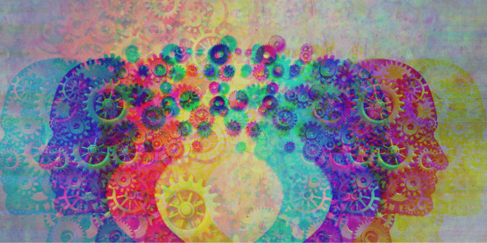

### And other misconceptions about human behavior

Marketers must understand people. Real people, not just psychology.

And it’s easy to conflate the two, I’ve been guilty of it myself. But we must remember a critical point about what psychology is. It seeks generalizable patterns that apply to *all people*.

But *all people* is evidently very different from the people you and I interact with daily.

Real people, the folks we meet in our lives, are deeply complex and deliberative. They make choices that seem alien to us, ones we couldn’t even begin to rationalize from our perspective.

But since I began studying marketing, I’ve been fed information about how people act in certain situations — a certain action begets a certain reaction. It just doesn’t correlate with my lived experience.

Many marketers seem to think of psychology as a ‘Best Practices Guide’ for influencing human beings —

Many marketers believe that when someone is shown a certain color, they will react in this way. When someone is given a certain type of content, they will react in that way.

It’s because popular marketing “gurus” make bold, sweeping claims about how people act. Then back these claims up with studies & evidence to prove their point — although the data they point to are actually insignificant or simply do not fully explain what the guru says it does.

But to the unsuspecting marketer, the guru’s evidence seems compelling. Especially since they conveniently neglect any evidence that may go against their point.

Because of this environment, it’s easy for marketers to fall into the trap of thinking that their audience is predictable. To think that people simply act out of impulsive emotion and post-rationalize their lives away.

But it doesn’t take a long look around to realize that’s simply not the case. Not for real people.  
 —

As marketers, we always want to gain actionable conclusions from past data. Data-driven decisions are the holy grail of marketing decisions, aren’t they?

But this fetishization of data has a downside. It leads marketers to derive conclusions from insignificant data. And I think that’s what happened with a lot of marketing psychology.

It would be convenient if past studies of human behavior could predict future behavior for your customers & if human behavior could be boiled down into patterns. But here’s the truth:

1 — Psychology studies that marketers use to back up their bold claims focus on a limited number of participants, oftentimes from a limited demographic.

(ex: American college students are often used as participants in psychology studies that people reference to support generalizable claims. However, American college students have a very different way of life than the large majority of the world’s population, calling into question the generalizability of these conclusions.)

2 — Broad, singular causes are given to account for events that were caused by many variables. This is very common in marketing studies.

(ex: Explaining a brand’s meteoric social media growth with a checklist of best practices including times to post and types of posts, while failing to explain the nuanced relationship the brand developed with its very unique audience.)

3 — Oftentimes, the conclusions drawn from a psychology study are very narrow. But journalists and other influencers cite these studies and make broad claims about their generalizability & applicability.

4 — If human behavior *is* as predictable as some marketers think it is, those marketers are taking an ethical stance when they “use” this information to persuade people who don’t know their true motivations.  
—

Marketers are never speaking to “all people”, especially not in early-stage companies. As marketers, we’re always speaking to a very specific person with very unique pains and desires.

That’s why marketers shouldn’t turn to gurus who explain “how people think & behave.” Instead, we should look at how our customer, a real person, thinks & behaves.

After all, marketing is about relationships between a brand and its customers. And I think this is an important distinction to make for marketers, especially in the research phase.

Relate your relationship with customers to your real-life relationships. Many times, the people we have the closest relationships with know us better than we know ourselves, and NOT because they have such a great understanding of human psychology as a whole.

Our closest friends and family know us best because they’ve spent time with us, and experienced life alongside us. They’ve seen the things that make us tick, our unique obsessions and desires.

It’s something worth thinking about for marketers when they’re researching their target audience. Instead of treating them as a manifestation of behavioral psych principles, maybe we should treat them like real people.

Put yourself in their shoes — be in their groups, have conversations with them about the things they care most about. And notice everything.

Notice what irks them, what gives them energy, what they seem to want out of life.  
 —   
I want to make it very clear that I would never condemn studying psychology. I think a background in psychology is the best starting point for a career in marketing, and it’s worth every marketer’s time to invest time to study it.

But we need to be very clear about why it’s important.

Psychology is important because it reveals intentions that aren’t obvious to us — in ourselves and others.

We can’t look at psychological research and think that it’s going to give us clues into how our target audience will act. And it’s not a prescription for influencing people toward a certain behavior.

This critique is not about the work being done in social psychology. It’s about the way that marketers present psychological findings to other marketers.

My advice to marketers is this: Instead of seeking predictable ways that people behave and hacks to influence people to do what you’d like, build relationships with your target audience, understand them, and deliver them a solution they need.

Treat your audience like real people. Because they are real people.

—

---

*Originally published on [Medium](https://medium.com/@kylejennings57/what-marketers-get-wrong-about-psychology-a635d725291d?source=rss-7ed4dad6c320------2).*
