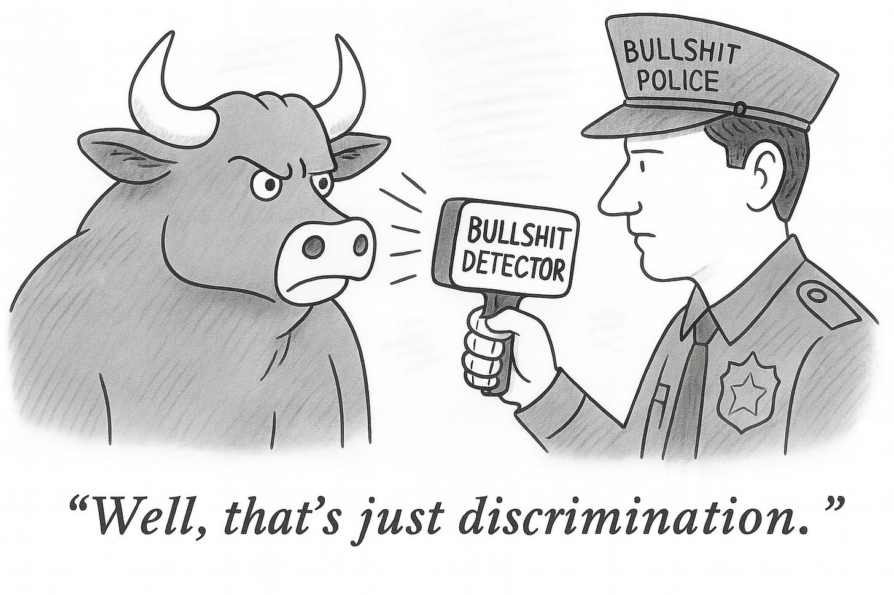

### My 3-W Status

1: **W**here*: Hilton Head, South Carolina (beautiful weekend with family)*2: **W**hat I’m listening to*: [Khrua Mea](https://open.spotify.com/track/79fBM5KdN2xzGgF9MvseO3) by Thriftworks*3: **W**hat’s present for me right now*: I’m really focusing on a consulting offer for my business — figuring out higher-leverage ways to utilize my skillset (so I can make more $$$ and a bigger impact).*

HAVE A MOMENT? REPLY WITH **YOUR OWN 3-W STATUS**!

### Hiya!

First things first… what is this?

I’m going to write a weekly (or whenever I feel like it) Newsletter as my attempt to return to one of the [Internet’s original promises](https://www.youtube.com/watch?v=4tl0UzczTBI&t=365s) - **to connect**.

And since *social* media has become a lot less *social[1](https://kylejennings.substack.com/p/this-week-in-kyle-1-hi#footnote-1)*, I’m hoping email is a better medium for genuine connection. A bit more personal, or something like that.

I’m also not a short-form person. I ramble and go off on tangents - my entire life has been a series of tangents, if I’m being honest - maybe an after-effect of smoking weed during my developmental years. *Case in point*.

So this will be a weekly Newsletter for me to share…

- My 3-W status (see above)
- What I’ve written (see below)
- Some reccs
- A few photos from the week
- Anything else I feel like sharing (no structure here, really)

And I’d love to hear back from you - the person reading this right now - the one with the thumbs and the eyeballs and whatnot. *I see you*.

Or hit Unsubscribe if all this sounds annoying or uninteresting – all good. I’ll love you anyway.

### The Bullshit Detector 3,000

##### My self-defense against fake experts, distortion of facts, and online manipulation

A few of the facts.

1️⃣ **Everyone’s fighting over your eyeballs**.

Because if you’re not paying attention, they can’t sell you shit.

People blame the algorithm for hijacking our hardwired instincts and biological wiring to keep us scrolling.

But I think we need to give some credit where it’s due - to the social media personalities themselves, who’ve also mastered the art of manipulating our attention.

Competition drives everything. And as people compete for your attention and loyalty, they simply become more adept at pulling the levers of our shared human psychology - curiosity, outrage, novelty, validation.

And as Tim Ferriss says about the social media apps…

> “All these companies are very smart. They have very good data scientists. They have very good UI specialists ... You’re bringing a knife to a gunfight if you think you can use your self-control to keep your use of Instagram to, say, 10 minutes.”

… the same applies to thought leaders and influencers who are incentivized to grab your attention and shape your beliefs.

We should expect that these folks are getting better at exploiting our evolved psychology than we realize. Expecting awareness of the problem to be a good enough defense against professional manipulators is like bringing a knife to a gunfight.

That’s where The Bullshit Detector 3,000 comes into play.

2️⃣ **We’re incredibly biased (yes, YOU too)**.

[SEE THE FULL POST](https://kylejennings.substack.com/p/bullshit)

### Some reccs (wat I’ve loved lately)

📹 Listers ([YouTube Link](https://www.youtube.com/watch?v=zl-wAqplQAo)): A **documentary** about extreme birdwatching. It’s hilarious and interesting and inspiring – and you definitely don’t need to be into birds. Highly recommend.

📖 *The Creative Act: A Way of Being* by Rick Rubin ([Amazon Link](https://www.amazon.com/Creative-Act-Way-Being/dp/0593652886)): Emphasis on the subtitle “a way of being,” since this is more about a way of existence than a ‘how-to’ for creative projects.

💻 the hunger to be everything @odetoapoet ([Substack Link](https://open.substack.com/pub/odetoapoet/p/the-hunger-to-be-everything?r=dq4x4&utm_campaign=post&utm_medium=web)): This **blog** gave language to a lot of the struggles I’ve had since entering this “real adult” phase of my existence – a constant sense of “what if there’s something better?”

### Pictures & stuffs

### Other stuff(s) I’ve done lately

◾ [Learning Freelance Blog](https://learningfreelance.substack.com/): Just created this new Substack blog to share what I learn along the way to building a sustainable freelance business.

The freelancing resources I’ve come across are either too dogmatic (convincing you that there is 1 way to succeed) or just plain crappy (more about SEO than helping people)...

So I want this to be a more true representation of freelancing than I’ve found to this point.

◾ 7 Unexpected Benefits of Freelancing ([Substack Blog](https://open.substack.com/pub/learningfreelance/p/7-unexpected-benefits-of-freelancing?r=dq4x4&utm_campaign=post&utm_medium=web&showWelcomeOnShare=false))

◾ 7 Things They Don’t Tell You About Freelancing ([Substack Blog](https://open.substack.com/pub/learningfreelance/p/7-things-they-dont-tell-you-about?r=dq4x4&utm_campaign=post&utm_medium=web&showWelcomeOnShare=false))

◾ Collecting Seeds ([Personal Website](https://kylewrites.com/collecting-seeds-11-28))

◾ Updated 🎵 In my ears lately 🎵 ([Spotify Playlist](https://open.spotify.com/playlist/4xrOrsEDiozJxuny4JEJdN?si=pLP075ZkRbSvXxo-DhRotg))

[1](https://kylejennings.substack.com/p/this-week-in-kyle-1-hi#footnote-anchor-1)

Since TikTok came on the scene, seems that all social media feeds have become 100% geared toward keeping you scrolling for as long as humanly possible. Used to be based on who you followed… now it’s completely curated by what the algorithm believes will keep you scrolling the longest. And the algorithm is pretty darn smart.

---

*Originally published on [Substack](https://kylejennings.substack.com/p/this-week-in-kyle-1-hi).*
